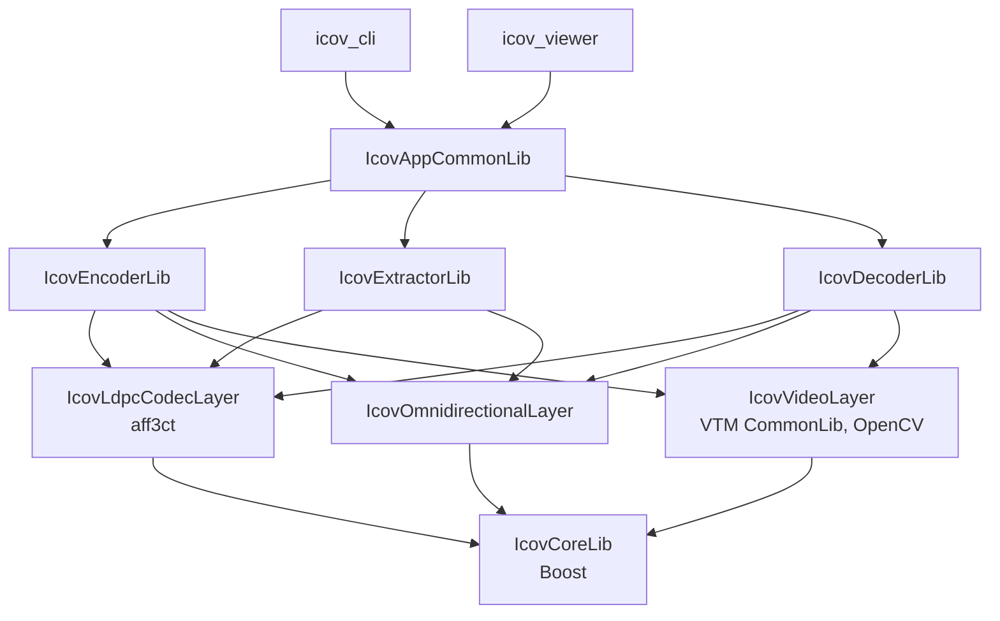
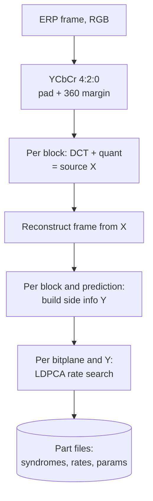
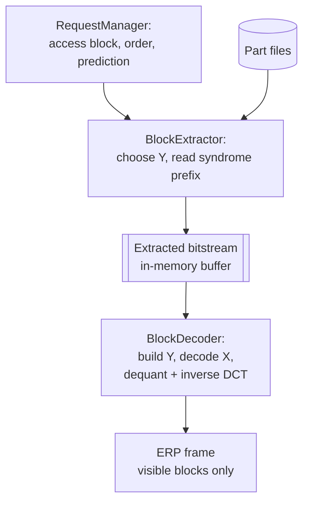

# ICOV core: architecture and internals

Developer documentation for `sebllns/icov_core`, describing version 1.6.0 (commit `1ef2f6e`, 2024-01-22) as found in the code. File paths are relative to the repository root. Statements marked **(to verify)** are inferences from reading the code that have not been confirmed by running it.

Scientific background: N. Mahmoudian Bidgoli, T. Maugey, A. Roumy, "Fine granularity access in interactive compression of 360-degree images based on rate-adaptive channel codes", IEEE Transactions on Multimedia, 2020, doi:10.1109/TMM.2020.3017890 ([arXiv:2006.14239](https://arxiv.org/abs/2006.14239)). LDPCA codes: D. Varodayan, A. Aaron, B. Girod, "Rate-adaptive codes for distributed source coding", Signal Processing 86(11), 2006.

---

## 1. What the codec does

ICOV compresses a 360 image or video **once**, so that later any viewport can be extracted and decoded without re-encoding, while the transmitted rate depends on the requested viewport and on the path taken to reach each block.

The core idea is distributed source coding:
- The picture is split into blocks (ICUs). Each block is coded **independently of how it will be decoded**: its quantized DCT coefficients `X` are the source.
- When a block is decoded, the decoder already holds some neighbor blocks (left, right, top, bottom, a corner pair, or the same block in the previous frame). From them it builds a **side information** `Y`, an estimate of `X`.
- The encoder does not know which neighbors the decoder will have. It therefore computes, for **every possible side information**, how many syndrome bits of a rate-adaptive LDPC code (LDPCA) the decoder would need to correct `Y` into `X`.
- The first block decoded in a viewport has no decoded neighbor, so no side information. For that case the encoder designates **access blocks** (section 5.3): a subset of blocks, chosen so that every viewport contains at least one, whose bitplanes are also stored as raw bits. Decoding of a request always starts from an access block, then spreads to neighbors using side information.
- It stores **one syndrome per bitplane, long enough for the worst side information**. Because LDPCA syndromes are nested, any shorter rate is a **prefix** of the stored one.
- At request time the extractor sends, per block, only the prefix matching the side information the decoder will actually use.

Consequence: the reconstructed pixels of a block do not depend on the navigation path (the decoder recovers `X` exactly; quality depends only on QP). Only the transmitted rate depends on the path.

---

## 2. Glossary

| Term | Meaning in the code |
|---|---|
| ERP | Equirectangular projection; the only projection implemented (`EquiRectPicture`). |
| ICU / block | Interactive Coding Unit: a square block of the ERP frame (default 32x32 luma). `Block` in the omnidirectional layer, `IcuEncoder` in the video layer. Ids start at 1; 0 means "no block". |
| TU | Transform Unit. In 1.6.0 there is exactly one TU per ICU (asserted in `FrameEncoder::encode_si`). |
| Prediction / SI | Side information type: `BlockPrediction::ePredType` (`RIGHT`, `LEFT`, `TOP`, `BOTTOM`, `TOP_RIGHT`, `TOP_LEFT`, `BOTTOM_RIGHT`, `BOTTOM_LEFT`, `INTER`, `NONE`). |
| Access block | A block coded without side information (`NONE`), sent as raw bits. Every possible viewport contains at least one, so decoding can always start. |
| Bitplane | Binary plane of the quantized coefficients in sign-magnitude form. Bitplane 0 is the sign, then MSB to LSB. |
| Numcode | Quantized rate index of an LDPCA code. Stored on 1 byte: `0` = SOURCE (raw bits), `1` = NO_CODING (hard decision on LLRs is already correct), `>= 2` = LDPCA code index + 2. |
| Stored syndrome | Per block, component and bitplane: the longest syndrome required over all side informations. |
| Doping | Extension above the maximum LDPCA syndrome length: raw source bits sent at positions ordered by least reliable LLR. |
| Request | `request_t { viewpoint_t {angleX, angleY}; frame_t frameID; }` in `lib/icov/core/common/icov_request.h`. |
| CPS | `ContentParameterSet`: stream header (resolution, QP, ICU size, viewport geometry, encoded blocks). |

---

## 3. Repository layout and build targets

```
lib/
  icov/
    core/                      IcovCoreLib: interfaces, common tools, LDPC core, stream formats
      common/                  types, logging, asserts, io, math, request_t
      omnidirectional_layer/   Block, RequestManager, BlockPrediction, interfaces
      ldpc_codec_layer/        BitSymbolProvider, QaryDistribution, LLRProvider, InteractiveCoder
      video_layer/             ContentParameterSet, icov_stream, encoded/extracted streams, debugger
      encoder/ decoder/        IEncoder / IDecoder interfaces
    ldpc_codec_layer/          IcovLdpcCodecLayer: IMT164 matrices + syndromes, aff3ct decoder, factory
    omnidirectional_layer/     IcovOmnidirectionalLayer: EquiRectPicture, BlockOrdering, access blocks, factory
    video_layer/               IcovVideoLayer: ICU/SI structures, intra prediction, DCT, quant (VTM-derived)
  encoder/                     IcovEncoderLib: media/frame encoder, output writers
  extractor/                   IcovExtractorLib: reads stored file, selects prefixes per request
  decoder/                     IcovDecoderLib: LDPC decoding + reconstruction per block
  app_common/                  IcovAppCommonLib: SinglePassDecoder, program options, encoder wrapper
  extensions/                  bitstream-utils (placeholder)
app/
  icov_cli/                    command-line tool (encode, decode, check, export, ...)
  icov_viewer/                 OpenGL/GLUT interactive viewer
  icov_demo_gui/               Qt demo (optional, ICOV_BUILD_GUI_DEMO)
third-party/
  aff3ct/                      git submodule (LDPC toolbox)
  vvc/                         vendored pre-VTM JVET "NEXT" 1.1 CommonLib + Utilities
data/                          LDPC matrices (imt_164_v2, imt_18, varodayan), q-ary table
tests/                         Boost.Test unit tests, benchmarks, RD scripts
```



Note: the extractor does not depend on the video layer. It only manipulates rates, parameters and syndrome bytes. This is what makes a lightweight server possible.

---

## 4. End-to-end data flow

The flow has two phases, shown as two diagrams.

**Encoding** (once, offline, `FrameEncoder`):



**Request** (per viewpoint and frame, `SinglePassDecoder`):



---

## 5. Omnidirectional layer

Location: `lib/icov/core/omnidirectional_layer`, `lib/icov/omnidirectional_layer`.

### 5.1 Picture and blocks
- `EquiRectPicture::buildConstantSizeBlocks` splits the ERP frame into `cols x rows` square blocks. Block coordinates are normalized `(u, v, w, h)` in [0, 1].
- Neighbor ids wrap horizontally (`getId` uses modulo on the column) because ERP is periodic in longitude. There is no wrap vertically: blocks in the top row have no `UP` neighbor, bottom row no `DOWN`.
- A block can be `hidden` (not encoded) when only a subset of blocks is encoded (`--encode-start-block`, `--encode-block-count`).

### 5.2 Viewport visibility
- `viewport_geometry` holds point of view (yaw, pitch), FOV, focal length and resolution (`icov_geometry.h`, `factory.h`).
- `ViewportManagerCenterPadded::isBlockVisible` projects block corners into the viewport, with a padding factor (`viewport_padding`, default 1.2 in the CPS). `DummyViewportManager` makes everything visible (debug).

### 5.3 Access blocks
`IcovAccessBlockManager::buildAccessBlocks` is a greedy cover. For each block in raster order, it points the viewport at that block's center; if no access block is visible yet, the block becomes an access block. Result: any viewport centered on a block center sees at least one access block. Access blocks are fixed at encode time and recomputed identically at decode time from the CPS.

### 5.4 Decoding order
`BlockOrdering::getNextBlock` (`lib/icov/omnidirectional_layer/implementation/BlockOrdering.cpp`) performs a depth-first traversal over visible blocks, starting from the first visible access block (`IAccessBlockManager::findAccessBlock`):
- When a block is processed, its neighbors are marked visible or not, and each visible neighbor records whether it now has horizontal and/or vertical side information.
- The next block is a neighbor of the top of the cursor stack, preferring one with both horizontal and vertical side information; otherwise the first available in the order RIGHT, LEFT, UP, DOWN.
- When the top block has no unprocessed visible neighbor, the stack is popped (backtracking).
- Complexity: O(visible blocks x 4) per request.

The ordering is deterministic given (viewpoint, picture, access blocks). Encoder-independent; both extractor and decoder rely on running the same ordering.

### 5.5 Prediction choice
`BlockPrediction::getPrediction` (`BlockPredictionManager.h`) chooses the side information from neighbors already processed in this request:
`UP` processed: `TOP_LEFT` if `LEFT` processed, else `TOP_RIGHT` if `RIGHT`, else `TOP`. Otherwise `DOWN` processed: `BOTTOM_LEFT` / `BOTTOM_RIGHT` / `BOTTOM`. Otherwise `LEFT`, then `RIGHT`. Access blocks use `NONE`. `INTER` is not chosen here; the extractor may switch to it (section 9).

Available predictions per block depend on the border (`getAvailablePredictions`): top-row blocks have no `TOP*`, bottom-row blocks no `BOTTOM*`.

### 5.6 RequestManager and the block processor tree
`RequestManager::update(request_t)` resets the ordering, sets the viewport, then iterates blocks in decoding order and calls `IBlockProcessor::processBlock(request, block, prediction, previouslyDecoded)`.

`IBlockProcessor` is a composite: a root processor with children. In `SinglePassDecoder`, the children are `BlockExtractor` then `BlockDecoder`, so for each block the extractor writes into the shared extracted bitstream and the decoder immediately consumes it. An `after` hook asserts the buffer is empty after each block.

`m_previousDecoded[block]` stores `frame + 1` of the last frame in which the block was decoded. It is what enables `INTER` prediction (block decoded in frame `f-1`).

---

## 6. Video layer

Location: `lib/icov/video_layer`, built on `third-party/vvc/source/Lib/CommonLib` types (`PelBuf`, `UnitArea`, `CompArea`, `QpParam`).

### 6.1 Frame preparation (`FrameEncoder::processInput`)
1. `resize_covering_blocks`: the frame is resized so width and height are multiples of the ICU size.
2. Buffers are allocated with a horizontal margin of `MarginX360Luma = 2` pixels on each side, used to copy the opposite border (`VTM_Utility::copyBordersFor360`) so intra prediction can wrap around longitude.
3. `cvMatToYUV`: BGR to YCbCr, default 4:2:0, 8-bit internal depth.

### 6.2 Source X: whole-block DCT and quantization
`VTM_Utility::quantizeFrame` loops over ICUs; for each (single) TU:
- `TransformUnit::save` copies the current quantized coefficients into `_previousQTcoeffs` (they become the `INTER` side information for the next frame).
- `Transform2D::transformNxN`: separable DCT-II on the full block (VTM fast butterflies, `ICOV_Transform2d.cpp`), 32x32 luma, 16x16 chroma for 4:2:0.
- `Quant::quant` at the frame QP (`--encode-qp`, default 42 in `FrameEncoder::params`).
- The reconstruction (dequant + inverse DCT) fills `PIC_RECONSTRUCTION`. This is exactly what the decoder will reconstruct, since `X` is recovered losslessly.

The source `X` is the vector of quantized DCT coefficients of the block itself, not a residual. The LDPC code length `n` is therefore the block area: 1024 for 32x32 luma, 256 for 16x16 chroma.

### 6.3 Side information Y (`EncodingStructure::applyPredictionBasedOnEntropy`)
For every ICU and every intra side information type allowed at its position:
- `IntraPrediction::initIntraPatternChType` builds reference samples from the **reconstructed** neighbors on the sides given by the prediction type (`REFERENCE_SAMPLE_SIDE`).
- Every intra mode is tried: luma modes 0 to `NUM_LUMA_MODE - 1` (planar, DC, 65 angular, plus one extra mode the vendored `CommonDef.h` describes as skip prediction; `NUM_LUMA_MODE = 68`), and 5 chroma modes (DM, planar, DC, horizontal, vertical). The value 68 is used as the `INTER` marker in the stream.
- For each mode: predict, DCT, quantize, then estimate the cost as the entropy of `X - Y` plus the bits to signal the mode. The mode with the lowest estimate is kept in `SideInformationUnit::intraDir[comp]`.
- `Y` for the intra case = quantized DCT of the intra prediction. `Y` for `INTER` = previous frame quantized coefficients of the same block (`getPreviousQT`), with no motion compensation.

The decoder repeats the same steps for the single chosen mode (`ChannelDecoder::_apply_intra_dir_mode`), which requires the neighbors to be already reconstructed: this is why the decoding order matters.

---

## 7. LDPC codec layer

Locations: `lib/icov/core/ldpc_codec_layer`, `lib/icov/ldpc_codec_layer`.

### 7.1 Binarization (`BitSymbolProvider`)
`compute_bits` converts symbols to `lx = binary_length(max |x|) + 1` bitplanes: plane 0 = sign, planes 1..lx-1 = magnitude from MSB to LSB. `injectBitplane` rebuilds symbols plane by plane during decoding.

### 7.2 Correlation model (`QaryDistribution`)
For one block and one side information, `Z = X - Y` is modeled as:
- `P(Z = z0) = q0`, where `z0` is 0 if 0 is inside `[zmin, zmax]`, else the bound closest to 0,
- uniform `(1 - q0) / (zmax - zmin)` on the rest of `[zmin, zmax]`, 0 outside.

Parameters sent per block, component and side information:
- `q0` quantized to an index in a table of 8 values (`data/q-ary/q`, defaults in the constructor),
- `zmin`, `zmax` quantized with step 16 in [-1024, 1024] (`Z_STEP`, `Z_LIMIT`), 1 byte each.
- `codingflag = false` when `X == Y` exactly: nothing else is sent for that side information.

### 7.3 LLRs (`LLRProvider`, `QaryDistribution::si_to_llr_*`)
- Sign plane: LLR from `pqks(y)`, probability that `x >= 0` given `y`.
- Magnitude plane `b`: LLR from `pqkb`, conditioned on the sign and on the magnitude prefix already decoded (`predec`). Bitplanes are decoded sequentially; each plane's LLRs use the previous planes.

### 7.4 Rate-adaptive codes (IMT164 family)
- `IMT164MatrixProvider` loads, for code length `n`, a mother parity-check matrix `H.pcm` (level 2, `m = n/2`) and combination files `C14`, `C18`, `C116`, `C132`, `C164` describing row merges for levels 4 to 64 (`m = n/4 ... n/64`). Intermediate rates are built by accumulating pairs of rows (`accumulateRows`). The available syndrome lengths are listed in `data/imt_164_v2/<n>/numcodes.txt`: first line = count, then the `m` values, and the last value is the doping threshold `m_max`. For `n = 1024`: `m` = 16 to 1024 in steps of 8, then 1040 to 1520 in steps of 16, threshold 512 (so 95 of the 158 codes use doping). For `n = 256`: `m` = 4 to 256, threshold 128. The code index stored in the numcode byte is the position in this list.
- `IMT164SyndromeManager::init_accumulation` computes the accumulated syndrome of the bitplane once; `compute_stored` returns its prefix of length `m`; `compute_deacc` converts a stored prefix into the syndrome of the code at that rate. This is what makes rates nested.
- Above `m_max = n/2`, `compute_stored` appends **doping bits**: raw source bits at positions given by the LLR reliability order (`LLRProvider::doping_order`), known to both sides.
- Matrix providers are shared per `(database, n)` in a static pool (`LdpcCoder_IMT64::matrix_provider_pool`).

### 7.5 Decoder
`Decoder_LDPCA_BP_flooding_SPA` (`lib/icov/ldpc_codec_layer/aff3ct/*.hxx`) is a sum-product belief propagation decoder with flooding schedule, adapted for syndrome decoding. It inherits aff3ct's `Decoder_LDPC_BP` and uses `Update_rule_SPA`. One decoder instance per matrix (`Aff3ctDecoder::init_decoder`); iterations from `ldpc_bp_ite` (default 100 in the CPS).

### 7.6 Rate search at encoding (`InteractiveCoder::encode_bitplane`)
For one bitplane and one side information:
1. If the hard decision on the LLRs already equals the source plane: numcode `NO_CODING`, empty syndrome.
2. Otherwise increase the code index `i` from the lowest rate, compute the stored prefix, **run the BP decoder**, and stop at the first `i` that decodes the plane exactly (`encode(NumcodeIdx&, ...)`).
3. If no code converges or an exception occurs, fall back to `SOURCE` (raw bits, rate 1).

This is trial decoding: encoding cost is roughly (number of rate steps tried) x (BP iterations) x (edges), per bitplane, per side information, per component, per block. It dominates encoding time.

### 7.7 What is stored per bitplane (`FrameEncoder::saveDataToEncode`)
For each block, component and bitplane:
- `stored_synd`: the longest syndrome over all side informations (worst case). Any side information's syndrome is a prefix of it.
- `stored_numcodes[pred]`: the numcode needed by each side information.
- If the cumulated intra rate over side informations exceeds `MaxRateNoCoding` (default 3.0), or a side information needs `SOURCE`, the bitplane is stored as raw source bits (`sourceFlag`), and all side informations point to `SOURCE`.
- Access blocks additionally store all their bitplanes as raw bits (section 8).

---

## 8. Encoder pipeline

```
IcovMediaEncoder::defaultEncode            build Visualization360 (picture, viewport, access blocks), fill CPS
 └ IMediaEncoder::encode                    loop frames
    └ FrameEncoder (IFrameEncoder::encode)  processInput: preparation, X, reconstruction, all Y
       └ for each non-hidden block (raster order)
          └ FrameEncoder::encodeBlock
             for each component c:
               #pragma omp parallel for over predictions (available intra SIs + INTER)
                 encodeBlockWithPrediction → encode_icu → encode_si → encode_tu
                   BitSymbolProvider(X, Y) → q-ary params → encode_bitplanes (rate search)
                   critical section: saveDataToEncode
             serializeBlockData: syndromes, then parameters, then block sizes
       endEncoding: frame sizes
```

- One `InteractiveCoder` per prediction and per code length (`LdpcParallelEncoder`), so the OpenMP loop over predictions does not share decoder state.
- `INTER` is attempted for every frame after the first.
- Optional `CheckBitplaneEncoding` re-decodes each encoded bitplane (`checkDecoding`), enabled through program options; costly.
- Per-block MSE between original and reconstruction is written to the metrics stream.
- `ExportRecoFrames` (default true) writes `source_frames/x<f>.tif` (reconstruction) and `v<f>.tif` (input) next to the output, used as ground truth by the decoder.

---

## 9. Stored file format (1.6.0)

The encoder writes **six files** in the output directory (`OutputIcovBase`, `encoded_stream.h::getIcovPartName`). The path given to `--output` is the directory anchor; the decoder opens the same set.

| Part | File | Content |
|---|---|---|
| `MEDIA_HEADER` | `header` | `ContentParameterSet`, Boost binary archive without header |
| `FRAMES_SIZE` | `fsize` | per frame: `uint32` parameter bytes, `uint32` syndrome bytes |
| `BLOCKS_SIZE` | `bsize` | per block per frame: `uint32` parameter bytes, `uint32` syndrome bytes |
| `ENCODE_PARAMS` | `prediction` | per block parameters (below) |
| `SYNDROME` | `syndrome` | per block stored syndromes, bit-packed MSB first |
| `METRICS` | `metric` | per block per frame: `float` MSE |

Each part except the header ends with three `0xFF` bytes (`endIcov`).

Per block, in `prediction` (all 1-byte fields), as written by `FrameEncoder::serializeParameters`:
```
for each component:
  bitplane_count
  stored_numcode[bitplane]          × bitplane_count
for each prediction in PredictionID order
    (INTER, TOP_RIGHT, TOP_LEFT, BOTTOM_RIGHT, BOTTOM_LEFT, RIGHT, LEFT, TOP, BOTTOM):
  for each component:
    dirmode                         0 = SI unavailable for this block, else mode + 1 (69 = INTER, i.e. mode NUM_LUMA_MODE = 68)
    if available:
      q_header                      0 = no coding (X == Y), else q0 index + 1
      if coding: zmin, zmax
                 numcode[bitplane]  × bitplane_count
```

Per block, in `syndrome`, as written by `FrameEncoder::serializeSyndrome`:
```
if access block:
  for each component: all bitplanes as raw bits (n bits per bitplane), bit-packed
for each component:
  for each bitplane: stored syndrome (or raw bits if sourceFlag), bit-packed, byte-aligned
```

Random access: the extractor accumulates `fsize` to find the frame start and `bsize` to find each block's offset in `prediction` and `syndrome` (`InputIcov::readBlockPos`, `setFrame`, `selectBlock`). There is no explicit index structure or checksum.

---

## 10. Extraction

`BlockExtractor::_processBlock` (`lib/extractor/BlockExtractor.cpp`), for each block in decoding order:
1. `selectBlock`: seek `prediction` and `syndrome` to the block.
2. For each component, read bitplane count and stored numcodes (`extract_stored_syndrome_size`).
3. If the block is decoded with an intra side information and it is an access block, skip its raw access bits.
4. **INTER check**: if `frameID > 0` and the block was decoded at `frameID - 1` (`previouslyDecoded`), read the `INTER` parameters and compute the total syndrome length.
5. Skip predictions until the one chosen by the RequestManager, read its parameters and syndrome length.
6. If `INTER` is allowed and not longer than the intra choice, switch to `INTER`.
7. For each component (`ChannelExtractor::extract_block_syndrome`), push to the extracted bitstream:
   ```
   bitplane_count
   if not access block: dirmode, q_header, [zmin, zmax, numcode × bitplane_count]
   for each bitplane: first ceil(m_pred / 8) bytes of the stored syndrome
   ```
   then skip the rest of the stored syndrome.

The extracted bitstream (`IcovExtractedBitstream`, `extracted_stream.h`) is a fixed 8192-byte ring buffer shared in memory between extractor and decoder; it is not a file format.

The decision of the prediction depends on client state (`previouslyDecoded`, blocks processed earlier in the same request). In the current architecture, extractor and decoder share that state because they run in the same process (section 12).

---

## 11. Decoding

`BlockDecoder::_processBlock` → `ChannelDecoder::decode_icu` for each component (`lib/decoder/ChannelDecoder.cpp`):
1. Pop `bitplane_count`.
2. If not an access block: pop `dirmode`. If `dirmode` encodes `INTER`, `Y` = this block's previous quantized coefficients. Otherwise run intra prediction with that mode on the reconstructed neighbors, DCT and quantize to get `Y`.
3. Pop `q_header` and, if coding, `zmin`, `zmax`; set the q-ary distribution. If no coding: `X = Y`.
4. Pop numcodes, then for each bitplane read `m` syndrome bits and call `InteractiveCoder::decode_bitplane`: `SOURCE` copies raw bits, `NO_CODING` uses the LLR hard decision, `NORMAL` runs BP on the de-accumulated syndrome.
5. After the last bitplane, write the symbols into the TU, then `inverse_QDCT`: dequantize and inverse DCT into `PIC_RECONSTRUCTION`; copy 360 borders.

Decoding cannot fail silently in theory, because the encoder verified convergence for every stored rate. In practice, BP is deterministic only if floating-point evaluation is identical between encoder and decoder builds **(to verify across compilers and flags)**.

---

## 12. Runtime composition and applications

### 12.1 SinglePassDecoder (`lib/app_common/decoder/SinglePassDecoder.cpp`)
`initLocal`:
1. Open the part files, read the CPS, compute block offsets.
2. Build LDPC parameters from the CPS (`codeLength = block_fixed_size²`, BP iterations, coder type) and the matrix database path.
3. `addDefaultNavigation`: `Navigation360` (picture, viewport from CPS, access blocks, `BlockPrediction`, `BlockOrdering`, `RequestManager`).
4. `addDefaultExtractor`, `addDefaultDecoder`: children of the root block processor, sharing one extracted bitstream.

`setRequest(r)` runs `RequestManager::update(r)`; the reconstructed frame is `getDecodedBuf()` (visible blocks only; others keep previous content or zero).

### 12.2 icov_cli modes (`app/icov_cli`)
`--mode` selects: `encode`, `decode`, `extract-gop`, `check`, `export`, `binary`, `symbole`. Main options (`lib/app_common/program/icov_program_options.h`): `--input`, `--output`, `--ldpc-coder-type` (`imt164`), `--ldpc-data-path`, `--ldpc-bp-ite`, `--encode-qp`, `--encode-icu-size`, `--encode-fov`, `--encode-viewport-padding`, `--encode-viewport-erp-horizontal-ratio`, `--encode-viewport-image-ratio`, `--encode-allblocks`, `--encode-start-block`, `--encode-block-count`, `--encode-start-frame`, `--encode-frame-count`, `--decode-positions-input` (CSV of `angleX, angleY, frame` per request), `--decode-csv-output`, `--decode-ground-truth`, `--decode-headless`.

### 12.3 icov_viewer (`app/icov_viewer`)
OpenGL/GLUT viewer: `InteractiveDecoder` wraps `SinglePassDecoder`; `single360degreecamerahandler` renders the ERP texture on a sphere; camera motion produces requests. `DemoEncoder` can encode and decode in the same process (used with the stream debugger).

---

## 13. Parameters and defaults

| Parameter | Default | Where |
|---|---|---|
| ICU size | 32x32 (square required) | `FrameEncoder::params::ICU_Size` |
| Chroma format | 4:2:0 | `FrameEncoder::params::ChFormat` |
| QP | 42 | `FrameEncoder::params::QP` |
| Internal bit depth | 8 | `FrameEncoder::params::InternalBitDepth` |
| 360 margin | 2 luma pixels | `MarginX360Luma` |
| Max cumulated intra rate before storing source | 3.0 | `MaxRateNoCoding` |
| BP iterations | 100 | `ContentParameterSet::ldpc_bp_ite` |
| Viewport padding | 1.2 | `ContentParameterSet::viewport_padding` |
| q0 table | 8 values (`data/q-ary/q`) | `QaryDistribution` |
| z quantization | step 16, range [-1024, 1024] | `Z_STEP`, `Z_LIMIT` |
| Rate field size | 1 byte | `ICOV_RATE_SIZE` |
| Matrix set | `imt164`, `n` = 1024 (luma), 256 (chroma) | `data/imt_164_v2` |

Supported code lengths are those with a matrix set on disk; with `imt_164_v2` that means 32x32 ICUs in 4:2:0.

---

## 14. Diagnostic tools

- **Log level** `--log-level`; Boost.Log or console backend (`ICOV_LOG_BOOST`).
- **Trace build** `ICOV_CORE_DEBUG_TRACE_ENABLED`: very verbose per-block, per-bitplane traces.
- **Assertions** `ICOV_ASSERTION_ENABLED` (ON by default): heavy checks in hot loops; disable for benchmarks.
- **Bitplane check** `CheckBitplaneEncoding` / `ICOV_CHECK_BITPLANE_ENCODING_ENABLED`: re-decode at encoding.
- **Stream debugger** `VideoStreamDebugger` / `VideoEncodingStreamCache` (`extracted_stream.h`, `ExtractedStreamDebugger.h`): singletons where the encoder caches expected values (bitplane counts, numcodes, modes, q-ary params) and the extractor/decoder assert against them. Only meaningful when encoding and decoding run in the same process.
- **Metrics** `VideoMetrics` singleton: per block decoding order, prediction, encoded and decoded bit lengths, MSE; exported by `CsvOutput` (`--decode-csv-output`) with ground-truth PSNR.
- **Sanitizers** ASan/UBSan in Debug on Linux (`ICOV_USE_ADDRESS_SANITIZER`, ON by default).

---

## 15. Performance notes

Hot paths, by expected cost (to confirm with profiling):
- **Encoder rate search** (7.6): trial BP decoding for each rate step, bitplane, side information (up to 9), component, block. Parallelized only over predictions.
- **Intra mode search** (6.3): 68 luma modes x (prediction + 32x32 DCT + quant + entropy estimate) per side information per block. Parallelized over ICUs.
- **Decoder BP**: one BP run per coded bitplane per decoded block; 100 iterations maximum. This sets the real-time budget for interactive playback.
- **Memory**: one `InteractiveCoder` (with its matrices' decoders) per prediction and per code length on the encoder side; matrix providers are shared.

---

## 16. Observations in the current code (to verify before refactoring)

| Location | Observation |
|---|---|
| `IEncoder.h` (`IFrameEncoder::encode`, `IMediaEncoder::encode`) | Exceptions are caught and logged per block and per frame; encoding continues and can silently produce an incomplete file. |
| `BlockExtractor.cpp`, `BlockDecoder.cpp` | Conditions written `if (true \|\| previouslyDecoded != r.frameID)`: the skip path for already-decoded blocks is disabled. |
| `RequestManager::update` | `use_previous_ordering` is computed then forced to `false`. |
| `SinglePassDecoder::setRequest` | `m_request.frameID %= framecount` modifies the stored request before comparison; the incoming `r` is not wrapped. |
| `ChannelDecoder.cpp` | `auto mp_icu_enc = m_encodingStruct->getICU(...)` copies an `IcuEncoder` by value at each call; correctness relies on VTM buffers being shallow copies, and it costs a copy per call. |
| Extractor, decoder, `InputMedia.cpp` | Many `std::cout` debug prints in hot paths. |
| Singletons | `VideoMetrics`, `VideoStreamDebugger`, `VideoEncodingStreamCache`, static `matrix_provider_pool`: global state prevents several independent decoders in one process (needed for a server). |
| CMake | `version.txt` and `lib/icov/core/common/version.h` written into the source tree at configure time. |
| File format | No magic number, version field or checksum outside the Boost-serialized header; offsets reconstructed by summing size tables. |

---

## 17. Implications for network streaming

What a remote client and server must share to reproduce the current single-process behavior:
- **Deterministic geometry**: CPS, ICU grid, access blocks, viewport model and padding. Both sides can compute these from the header.
- **Decoding order and predictions** for a request: deterministic from (viewpoint, frame, hidden blocks). Both sides can compute them.
- **`previouslyDecoded` per block**: depends on the client's history. Needed to decide `INTER` vs intra (section 10, step 4). This is the only state that the server cannot derive from the current request alone.
- **Extraction cost**: the extractor reads parameters and syndrome prefixes and never runs LDPC or video code, so a server needs only the extractor and omnidirectional layers.
- **Decoder state**: reconstructed frame and per-block previous coefficients. Purely client-side.

Two consequences for the protocol design:
- Either the client reports its decoded-block history (or the server mirrors it), or the client makes the `INTER`/intra choice itself and requests explicit `(block, prediction, rate)` byte ranges.
- Because rates are prefixes of a stored syndrome, the byte range for one `(block, component, bitplane, prediction)` is `[block_syndrome_offset + bitplane_offset, + ceil(m_pred / 8))`, which fits range requests once an explicit index replaces the summed size tables.
